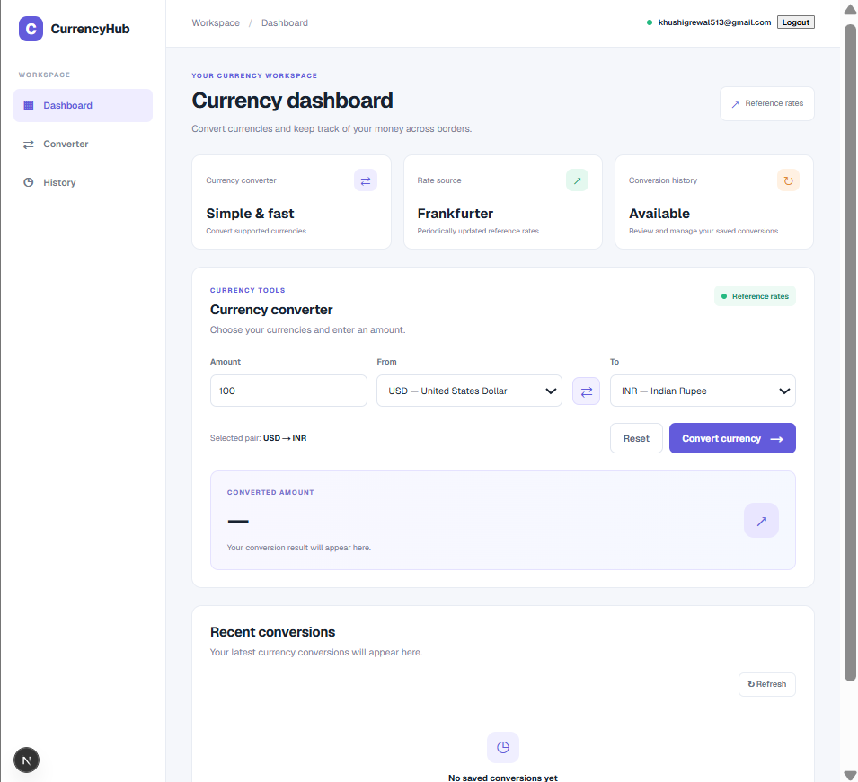
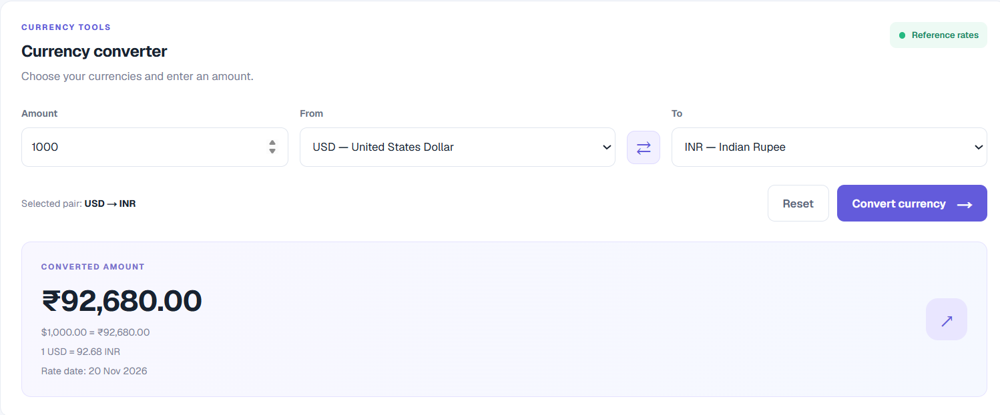
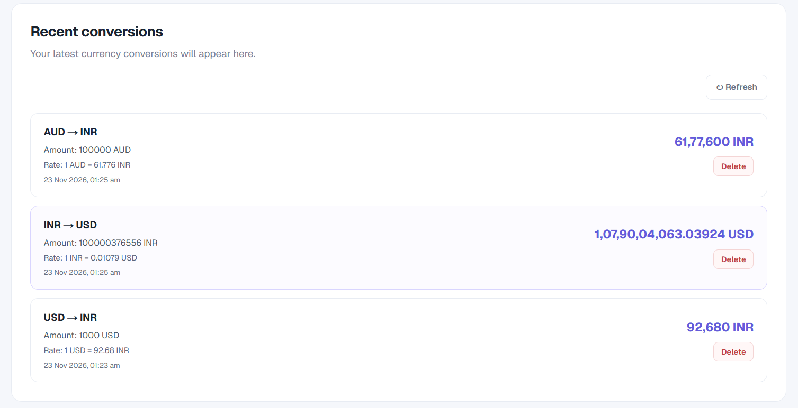
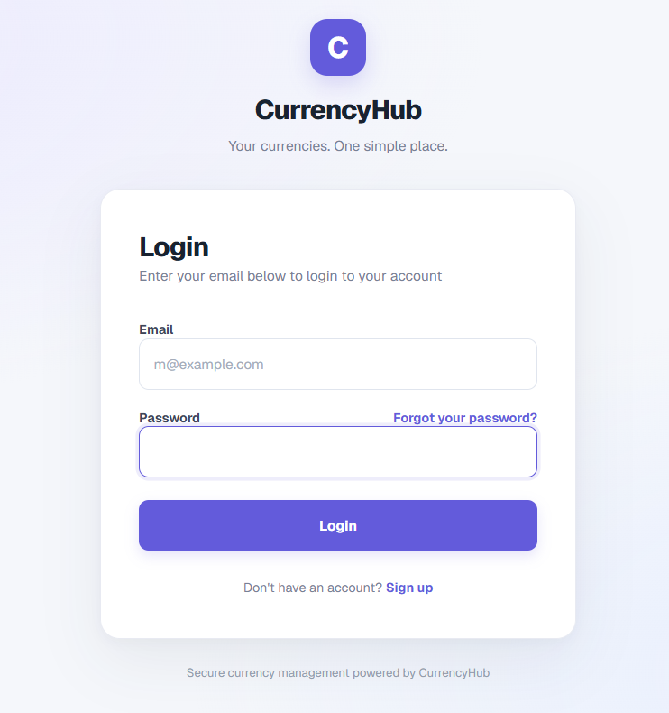
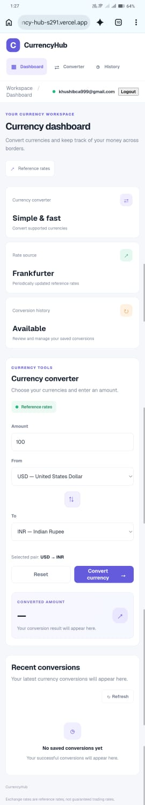

# CurrencyHub

A responsive currency conversion application built with Next.js, TypeScript, and Supabase. CurrencyHub allows users to convert currencies using exchange-rate data, manage their account, and keep a personal history of their conversions.

🔗 **Live Demo:** [https://currency-hub-s291.vercel.app/]  
📂 **Repository:** [https://github.com/khushibca999-pixel/CurrencyHub-.git]

---

## Overview

CurrencyHub is a full-stack web application designed to provide a simple currency conversion experience with user authentication and persistent conversion history.

Users can select currencies, convert amounts, view conversion results, and save their successful conversions to their account. Authenticated users can revisit their history, refresh it, and delete individual records.

The project focuses on building a practical application with frontend and backend integration, authentication, API handling, database operations, and deployment.

---

## Features

- **Currency Conversion** — Convert amounts between supported currencies using exchange-rate data.
- **Currency Selection** — Select source and target currencies.
- **User Authentication** — Sign up, sign in, and manage an authenticated session.
- **Protected Dashboard** — Restrict dashboard access to authenticated users.
- **Persistent Conversion History** — Save successful conversions to a database.
- **History Management** — View, refresh, and delete saved conversion records.
- **Responsive Interface** — Adapt the application layout to different screen sizes.
- **Input Validation** — Handle invalid or unsuitable conversion inputs.
- **Loading, Error and Empty States** — Provide feedback during data loading, failures, and when no history is available.

---

## Tech Stack

| Technology | Purpose |
|---|---|
| Next.js | Full-stack application framework and routing |
| React | UI development |
| TypeScript | Type safety |
| Supabase | Authentication and database |
| Supabase Auth | User registration, login and session management |
| CSS | Styling and responsive layouts |
| Exchange-rate API | Currency and exchange-rate data |
| Vercel | Production deployment |
| Git & GitHub | Version control and source code hosting |

---

## Application Architecture

CurrencyHub uses a frontend-to-API architecture.

- The frontend provides the converter, dashboard, authentication screens, and conversion history interface.
- Next.js API routes handle currency-related requests and history operations.
- An external exchange-rate provider supplies currency and conversion data.
- Supabase handles authentication and persistent user-specific conversion history.
- Protected application routes verify the user's authentication status before allowing dashboard access.

### API Routes

| Endpoint | Purpose |
|---|---|
| `GET /api/health` | Check API health |
| `GET /api/currencies` | Retrieve supported currencies |
| `POST /api/convert` | Perform a currency conversion |
| `GET /api/history` | Retrieve the authenticated user's conversion history |
| `POST /api/history` | Save a conversion record |
| `DELETE /api/history?id={id}` | Delete a conversion history record |

---

## Authentication & Data Security

- Authentication is handled through Supabase Auth.
- Protected routes require an authenticated user.
- Conversion history is associated with the authenticated user.
- Database access is protected using Row Level Security (RLS) policies.
- Users can access and manage their own history records.
- Environment variables are used for configuration.
- Sensitive credentials are not committed to the repository.

---

## Project Structure

```text
CurrencyHub/
└── docs/
    └── screenshots/
        ├── dashboard.png
        ├── conversion-result.png
        ├── history.png
        ├── login.png
        └── mobile.png
├── app/
│   ├── api/
│   │   ├── convert/
│   │   ├── currencies/
│   │   ├── health/
│   │   └── history/
│   ├── auth/
│   └── protected/
├── components/
│   ├── currencyhub-dashboard.tsx
│   └── conversion-history.tsx
├── lib/
│   └── supabase/
├── public/
├── .env.example
├── package.json
└── README.md
```

*Note: The structure above is a simplified overview. Refer to the repository for the complete source tree.*

---

## Getting Started

### Prerequisites

- Node.js
- npm
- A Supabase project

### 1. Clone the repository

```bash
git clone https://github.com/khushibca999-pixel/CurrencyHub-.git
cd CurrencyHub
```

### 2. Install dependencies

```bash
npm install
```

### 3. Configure environment variables

Create a `.env.local` file in the project root and add:

```env
NEXT_PUBLIC_SUPABASE_URL=your_supabase_project_url
NEXT_PUBLIC_SUPABASE_PUBLISHABLE_KEY=your_supabase_publishable_key
```

Use your own Supabase project credentials. Never commit `.env.local` or any secret credentials.

### 4. Configure Supabase

Set up your Supabase project with:

- Authentication enabled.
- The required email authentication settings.
- The conversion history table.
- Row Level Security (RLS).
- Policies that allow authenticated users to manage their own records.

Refer to the project implementation for the exact database schema and policies.

### 5. Start the development server

```bash
npm run dev
```

Open:

```text
http://localhost:3000
```

### 6. Create a production build

```bash
npm run build
```

---

## Conversion History

CurrencyHub stores successful conversions for authenticated users.

Each history record includes:

- Source currency
- Target currency
- Original amount
- Converted amount
- Exchange rate
- Creation timestamp

Users can retrieve their saved history, refresh the list, and delete individual records.

The history feature includes loading, error, and empty states to provide feedback during different application states.

---

## Screenshots


## Screenshots

### Dashboard


### Currency Conversion


### Conversion History


### Authentication


### Mobile Layout


---

## Deployment

CurrencyHub is deployed using Vercel.

The application can be deployed by connecting the GitHub repository to Vercel and configuring the required environment variables for the production environment.

**Live application:** [https://currency-hub-s291.vercel.app/]

---

## What I Learned

Building CurrencyHub helped me practice and understand:

- Building a full-stack application using Next.js.
- Working with React and TypeScript in a practical project.
- Creating and consuming API routes.
- Integrating an external API.
- Implementing authentication and protected routes.
- Managing sessions with Supabase.
- Connecting an application to a database.
- Implementing CRUD operations.
- Applying Row Level Security to user-specific data.
- Handling loading, error, and empty states.
- Managing environment variables.
- Testing production builds.
- Version control using Git and GitHub.
- Deploying a project using Vercel.

---

## Future Improvements

Potential improvements for future versions:

- Favorite currency pairs.
- Historical exchange-rate charts.
- Search and filtering for conversion history.
- Export conversion history.
- Additional conversion-related tools.

These are future ideas and are not included in the current release.

---

**Built as a practical full-stack portfolio project.**